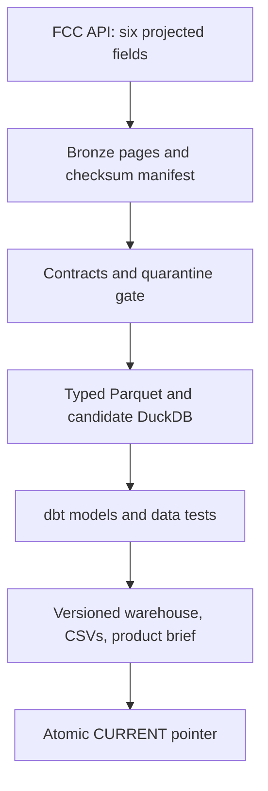

# Wireless Data Engineering

**Himanshu Jadaun · Personal learning projects on real public data**

A progressive engineering portfolio for retail wireless product questions. Week 1 builds a complete public telecom complaint data product: API extraction, immutable source snapshots, row contracts, typed Parquet, transactional warehouse loading, tested SQL models, asset orchestration, failure isolation, and published product-investigation tables.

This is independently developed personal work. It uses no EchoStar / Boost Mobile internal data, customer records, code, dashboards, business logic, or proprietary architecture. The source is the FCC's public complaint dataset. No production observations are generated or simulated.

## Start here

Read [the builder's guide](docs/BUILDERS_GUIDE.md), [the runbook](docs/RUNBOOK.md), and [the measured verification report](reports/VERIFICATION.md). The results-led [LinkedIn draft](posts/week-01-linkedin.md) pairs with a [five-page visual carousel](posts/assets/week-01/Week01_LinkedIn_Carousel.pdf); the [asset guide](posts/assets/week-01/README.md) includes chart data, alt text, and reproduction commands. [The series charter](series/CHARTER.md) defines the standard for subsequent releases.

**Named new technique: quality-gated, versioned data-product publication.** A candidate warehouse remains private until its contracts and dbt tests pass. Only then does one atomic pointer switch make the new release visible. Failed runs preserve the last good release.

## Run on your Mac

Prerequisites: Python **3.12**, a terminal, and Internet access for the first FCC download. Docker and cloud accounts are not required. Python 3.13 is allowed by project metadata but has not been verified here. Do not use macOS's older system Python. If needed, install Python 3.12 through your preferred Python manager.

Clone the repository, then create an isolated environment:

```bash
git clone https://github.com/Himalytics/wireless-data-engineering.git
cd wireless-data-engineering
python3.12 -m venv .venv
source .venv/bin/activate
python -m pip install -r requirements.lock.txt
python -m pip install --no-deps -e .
wireless-de run --start 2025-09-01 --end 2025-10-01
wireless-de inspect
python -m pytest -q
```

If your `python3` is already Python 3.12, it can replace `python3.12`. The date window is **start inclusive, end exclusive**. The fixed historical month keeps the first run bounded and reproducible enough to investigate; it is not presented as current market intelligence.

Run again without network access:

```bash
wireless-de run --offline
```

Refresh the same source window deliberately, or ingest another closed period:

```bash
wireless-de run --refresh
wireless-de run --start 2025-10-01 --end 2025-11-01
```

The full downloadable package includes the captured source snapshot for the default month. A source-only GitHub checkout downloads it on first run. Source data and local databases are ignored by Git.

## End-to-end flow



Dagster executes five assets: `fcc_snapshot`, `contracted_rows`, `warehouse_candidate`, `dbt_quality_gate`, and `published_data_product`. Python downloads data and validates the boundary. Polars enforces the typed Parquet schema. DuckDB stores the local analytical warehouse. dbt owns SQL dependencies and warehouse tests. Dagster makes stage ordering and failure propagation explicit.

## Real source and licence

| Item | Value |
|---|---|
| Publisher | Federal Communications Commission |
| Dataset | CGB – Consumer Complaints Data |
| Dataset identifier | `3xyp-aqkj` |
| Catalogue | https://catalog.data.gov/dataset/cgb-consumer-complaints-data |
| API | https://opendata.fcc.gov/resource/3xyp-aqkj.json |
| Metadata | https://opendata.fcc.gov/api/views/3xyp-aqkj.json |
| Licence in publisher metadata | Public Domain U.S. Government |
| Licence reference | https://www.usa.gov/government-works |
| Default extraction | September 1–30, 2025 |
| Download method | Python Requests; SoQL projection, bounded keyset pagination, before/after counts and metadata checks |

Only `id`, `date_created`, `issue_type`, `method`, `issue`, and `state` are requested. Phone-number, address, exact-location, and narrative fields are not requested. Test fixtures contain 24 observed records projected to the same fields, with a retrieval URL and checksum. Bad rows and deletion/corruption scenarios in tests are **explicit fault injection**, not analytical observations.

The FCC states that complaints are consumer-selected reports and it does not verify the alleged facts. This is not a census of service problems and has no subscriber exposure denominator.

## Engineering properties

- **Bounded extraction:** keyset pagination by source complaint ID, explicit page limit, and source-count reconciliation. Hitting the cap is an error, never a quiet sample.
- **Replayable evidence:** source page checksums, content-derived snapshot identity, retrieval time, query parameters, and source metadata. Cache use is visible in the run summary.
- **Contracts:** strict projected fields, ID/date/type checks, a documented missing-value policy, duplicate detection, quarantine output, and zero rejected rows before loading.
- **Repeatable loading:** re-extracted date windows replace their previous contents transactionally. Duplicate replays do not append duplicate records. Deletions inside a refreshed window are reconciled.
- **Failure isolation:** single-writer lock, bounded HTTP retries, candidate warehouse copy, dbt gates, and atomic release publication.
- **Auditability:** per-run status, elapsed time, environment details, Dagster events, dbt results, source lineage, and exported product tables.

The before/after source checks provide **best-effort extraction consistency**. The FCC API does not expose a snapshot transaction token. This project does not claim distributed exactly-once delivery, comprehensive CDC, high availability, or proven performance at enterprise volume.

## Product output

The warehouse includes daily and weekly wireless complaint counts and an issue-priority table. It compares the latest consecutive **fully ingested** weeks, flags incomplete periods, and makes zero filling conditional on date coverage. A deliberately simple triage threshold of 20 complaints is an illustrative configurable policy, not a statistically established alarm.

The product decision is which complaint themes deserve research, such as billing or number portability. Measure investigation yield and time-to-detection. Validate any product intervention separately with an appropriate experiment and actual outcome denominators. No carrier ranking, churn reduction, revenue impact, or causal effect is inferred here.

## Outputs

`data/CURRENT.json` points to the published directory under `data/releases/`. That release contains:

| Output | Purpose |
|---|---|
| `warehouse.duckdb` | Raw, operations, and analytics schemas |
| `exports/daily_wireless_issues.csv` | Counts by day, state, service type, and issue |
| `exports/weekly_wireless_issues.csv` | Weekly counts and coverage flags |
| `exports/issue_priorities.csv` | Latest complete-week comparison |
| `product_brief.md` | Product questions and evidence limits |
| `summary.json` | Counts, source identity, gate outcomes |
| `execution.json` | Runtime, environment, and orchestration evidence |
| `dbt_target/run_results.json` | Actual model/test outcomes |

`data/bronze/` retains source snapshots; `data/runs/` records run outcomes; failed candidates remain in `data/work/` for diagnosis. Do not edit published releases. Readers resolve `CURRENT.json` once and keep using that version for the duration of a query.

## Next release

Week 2 adds checkpointed ingestion and change reconciliation over real public source refreshes. Injected late-arrival/change scenarios will be identified as fault tests. We will distinguish `complaint_date`, source-revision observations, and ingestion time instead of inventing customer histories.

See [the twelve-week sequence](series/ROADMAP.md). The initial stack is chosen to run locally in one sitting; later infrastructure must earn its complexity through an explicit workload.
