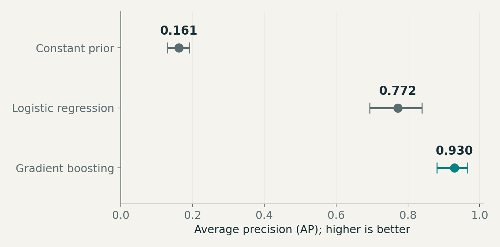

# Retail Wireless Data Science Lab

**Himanshu Jadaun · Applied Data Science and Machine Learning · Real public data**

A progressive portfolio of empirical studies: define a product question, audit the observations, compare justified methods, quantify uncertainty and explain the decision the evidence supports. Each project includes runnable Python, an executed notebook, saved evaluation results, reproducible scientific figures and a detailed builder's guide.

[Projects](#projects) · [Run Project 1](#run-project-1) · [Roadmap](docs/ROADMAP.md) · [Scientific standard](docs/SCIENTIFIC_STANDARD.md) · [Sources](sources/CATALOG.md)

## Projects

| Project | Question and technique | Status |
|---|---|---|
| [01 · Churn risk](projects/01_churn_risk/README.md) | Can we trust churn-risk probabilities? Nested group-aware tuning and calibration; ranking, probability error and capacity analysis. | Built and evaluated · October 26, 2026 |
| 02 · Complaint-volume forecasting | How predictable are real, dated telecom complaint volumes? Rolling-origin forecasting, seasonal baselines and uncertainty coverage. | Planned · November 2, 2026; source feasibility pending |

The [twelve-project roadmap](docs/ROADMAP.md) progresses through forecasting, geographic analysis, uplift, experimentation, customer value, recommendation and NLP. Planned work is not presented as an evaluated result.

## Project 1: measured findings

All primary results use **639 held-out records, including 103 churn labels**, from the observed UCI Iranian Churn dataset. Model choice used development-only out-of-fold Brier score. Identical conservative predictor profiles remain grouped across every evaluation boundary.

| Model | Average precision ↑ | Brier error ↓ | ROC-AUC ↑ |
|---|---:|---:|---:|
| Constant development prior | 0.161 | 0.1352 | 0.500 |
| Logistic regression · 11 predictors | 0.772 | 0.0727 | 0.931 |
| Gradient boosting · 11 predictors | **0.930** | **0.0372** | **0.982** |

The selected model's top 64 predictions contained 63 of the 103 churn labels. Sigmoid calibration slightly worsened Brier error relative to its matched raw ensemble: 0.0361 to 0.0372. Both findings are retained.



This historical Iranian source-sample result is not a chronological backtest, a current U.S. carrier estimate or a measured retention effect. Read the [complete findings and limitations](projects/01_churn_risk/RESULTS_REPORT.md), [dataset card](projects/01_churn_risk/DATA_CARD.md) and [model card](projects/01_churn_risk/MODEL_CARD.md).

## Run Project 1

Use Python **3.12** on macOS or Linux. From a terminal:

```bash
git clone https://github.com/Himalytics/wireless-data-science.git
cd wireless-data-science/projects/01_churn_risk
python3.12 -m venv .venv
source .venv/bin/activate
python -m pip install --upgrade pip
python -m pip install -r requirements.txt
python run_study.py
python -m unittest discover -s tests -v
python build_figures.py
```

The study downloads and verifies the publisher input automatically. No API keys or paid services are required. The recorded full study ran on Linux/Python 3.12.14; the [integrity workflow](https://github.com/Himalytics/wireless-data-science/actions/workflows/scientific-integrity.yml) checks the project on Linux and macOS. Runtime and installation speed vary by machine.

For the explanatory notebook:

```bash
python -m pip install -r requirements-notebook.txt
python execute_notebook.py
```

The [executed notebook](projects/01_churn_risk/analysis.ipynb) is also viewable on GitHub. Start with the [two-hour builder's walkthrough](projects/01_churn_risk/BUILDERS_GUIDE.md) to understand and defend the study.

## Repository structure

| Directory | Contents |
|---|---|
| `projects/` | Self-contained studies: code, requirements, notebooks, tests, reports, cards, predictions and scientific figures |
| `docs/` | Project standard, scientific release criteria, roadmap and current series state |
| `sources/` | Public dataset catalogue with appropriate uses and limits |
| `templates/` | Reusable experiment, model-card, findings and builder-guide structures |
| `.github/workflows/` | Automated scientific integrity checks |

## Scientific principles

- Use observed public data, with source attribution, licence and reproducible input identity.
- Keep fitting, preprocessing, tuning and calibration within their proper training boundaries.
- Compare against useful baselines and report uncertainty, sensitivity and supported error analysis.
- Separate ranking quality, probability quality and causal business impact.
- Preserve negative findings and state what additional evidence a decision requires.

These are independent personal studies. They use no employer data, internal systems or proprietary designs. See the [project standard](docs/PROJECT_STANDARD.md) and [scientific standard](docs/SCIENTIFIC_STANDARD.md) for the complete requirements. Dataset-specific licences and attribution appear in each study's data card.
