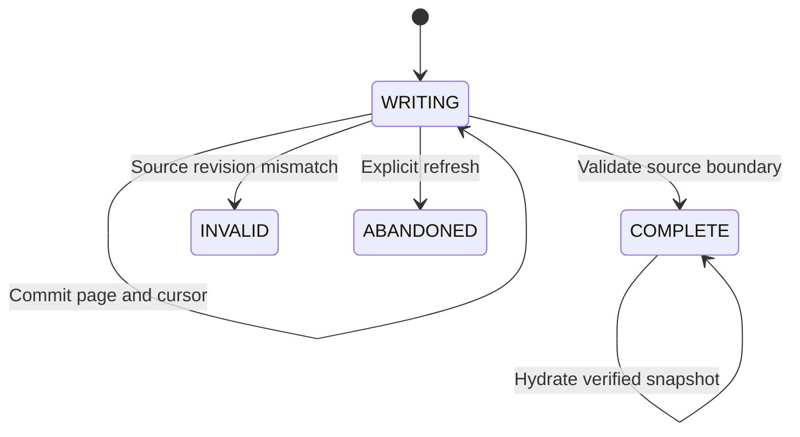

# ADR 0002: commit page bytes and cursor together

Status: implemented reference design. Scope: local, single-writer, bounded public FCC extraction.

## Problem

The first ingestion path discarded unfinished downloads on handled errors and restarted an interrupted extraction. Retrying a request did not provide persistent recovery. A cursor advanced before its payload is durable can permanently skip records; a payload persisted before a separate cursor commit creates an orphan/replay problem.

## Decision

Store each raw page, its checksum, query, cursor range, and row count in a SQLite ledger. Update session progress in the same explicit transaction as the page insert. Use WAL mode, FULL synchronization, foreign keys, a unique committed page key, a single WRITING session per job, and a local writer lock.

The actual public API remains outside this transaction. A page may be fetched again after an interruption. The demonstrated guarantee is consistent local committed progress, not exactly-once HTTP delivery.

## State machine

Before resuming WRITING work, compare selected source metadata and source count with the captured boundary. A mismatch invalidates the session. Because the source has no transactional snapshot token, matching stamps are still best-effort consistency checks.

After all pages and final source checks pass, mark the session COMPLETE. Hydrate immutable bronze files from verified committed BLOBs, then use the existing row-contract and warehouse quality gates. The bronze pointer and data-product pointer remain separate.

## Alternatives considered

| Alternative | Benefit | Cost or risk |
|---|---|---|
| Cursor JSON plus separate raw files | Simple files, natural object-storage migration | Requires a carefully tested write order and orphan reconciliation across stores |
| Cursor only, repeat every prior request | Minimal durable state | Redownloads work and cannot independently verify retained page bytes |
| Page bytes and cursor in one SQLite transaction | One local atomic boundary; reproducible process-kill experiments | Duplicates payload storage when bronze is hydrated; local DB grows with retained raw pages |
| Distributed control plane and object store | Can support multiple hosts and separate scalable storage | Requires lease/fencing, permissions, deployment, and genuinely cross-host tests |

The SQLite choice is justified by the bounded local workload and by avoiding an unproven two-store protocol. It is not a claim that a growing BLOB ledger is the right large-scale architecture.

## Evidence and limits

Tests kill a child process immediately before and after a checkpoint commit, and after COMPLETE before hydration. Other checks cover HTTP retries, changed source revisions, page budgets, corruption, refresh, and offline replay. See the generated verification report for actual results.

Process termination is not power-loss testing. FULL synchronization requests stronger persistence behavior, but filesystem, disk, and hardware guarantees still matter. The file lock is local; it is not a distributed lease or fencing mechanism. SQLite files in WAL mode must not be casually copied as if the main database alone were a complete live backup.

The downstream contract still collects validated rows in memory; the warehouse still copies its previous release. This change improves extraction recovery, not every scaling boundary. A complete cache is deliberately reusable until explicit refresh; it is not a source-freshness policy.

Primary references: [SQLite WAL](https://www.sqlite.org/wal.html), [SQLite transactions](https://www.sqlite.org/lang_transaction.html), [synchronous pragma](https://www.sqlite.org/pragma.html#pragma_synchronous), and [Python subprocess return codes](https://docs.python.org/3/library/subprocess.html#subprocess.CompletedProcess.returncode).
