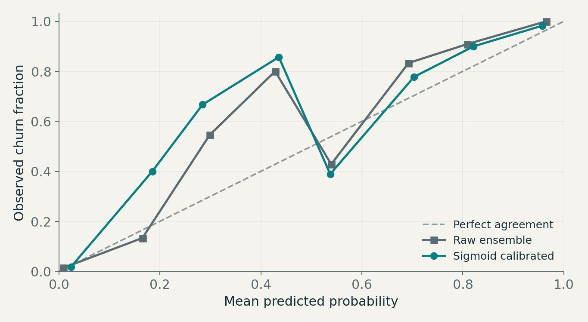
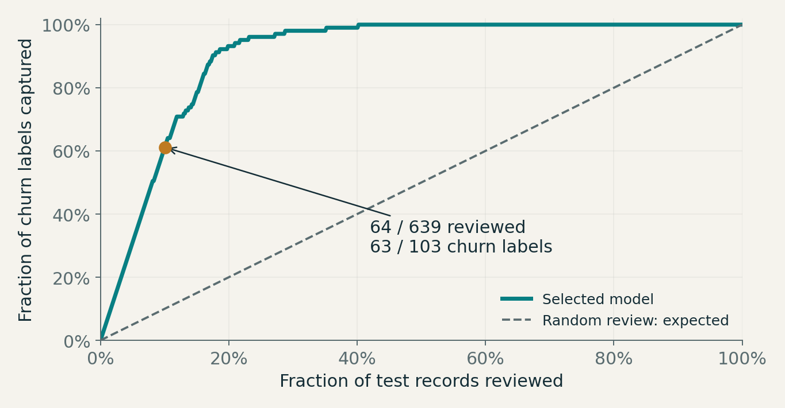

# Findings · ranking is useful; intervention benefit is unmeasured

Executed October 26, 2026. Question: can defensible churn probabilities and a ranked review queue be built from observed telecom data? Unit: one source record. Target: month-twelve churn state following a first-nine-month predictor window. Intended decision: whether the ranking merits prospective target-domain validation before an offer experiment.

## Design before outcomes

The protocol in `experiment_plan.json` specified a constant-prior baseline, regularized logistic regression and histogram gradient boosting. Primary models exclude Status and Customer Value; all-field comparisons are secondary. These exclusions are conservative operational choices, not evidence of leakage. See `DATA_CARD.md` for source attribution, missingness and repeated-profile audit.

Identical 11-field predictor profiles stay together in every split. The first fold of five shuffled stratified group folds (seed 42) yields **2,511 development / 639 final test rows**, with **392 / 103 churn labels**. Group intersection is zero. This is profile-aware random validation, not a chronological test or proof of customer independence.

Within development, three outer folds evaluate candidates. Each outer-training portion has three calibration folds. Each calibration-training portion independently fits preprocessing and a three-fold grouped hyperparameter search. The calibration fold is unseen by tuning and fitting. Logistic searches C ∈ {0.1, 1, 10}; boosting searches leaves ∈ {7, 15} × L2 ∈ {0, 2}, with 120 iterations, learning rate 0.08, min leaf 20, and early stopping disabled. Classes are not reweighted or resampled; unweighted probability prediction is the objective.

Select the eligible model using **pooled development OOF Brier**: prior 0.13174; logistic 0.07173; boosting 0.03884. The saved selection record is written before final test prediction and scoring. Then fit three independently tuned/calibrated submodels per candidate on development data and average their probabilities. No final-test choices are optimized after reading its metrics.

## Held-out evidence

Average precision (AP) is the non-interpolated ranking metric from scikit-learn, not trapezoidal PR area. Higher AP/ROC-AUC and lower Brier/log loss are better. All rows below use the same 639-row holdout.

| Model | AP (conditional 95% interval) | Brier | Log loss | ROC-AUC |
|---|---:|---:|---:|---:|
| Constant prior | 0.1612 (0.1298–0.1913) | 0.13523 | 0.44173 | 0.5000 |
| Logistic / 11 fields | 0.7717 (0.6940–0.8394) | 0.07267 | 0.24645 | 0.9309 |
| Boosting / 11 fields | 0.9298 (0.8808–0.9664) | 0.03721 | 0.13466 | 0.9824 |
| Logistic / 13 fields, sensitivity | 0.7608 (0.6825–0.8336) | 0.07372 | 0.24630 | 0.9320 |
| Boosting / 13 fields, sensitivity | 0.9415 (0.8965–0.9735) | 0.03558 | 0.13068 | 0.9850 |

Intervals use **500 paired bootstrap resamples of complete held-out conservative profile groups**. They condition on the fitted models and this source sample; they exclude much of training, source-selection, temporal and geographic uncertainty. No t-test treats fold scores as independent replicates. The paired Brier difference (boosting minus logistic) has a conditional 95% interval of **−0.04918 to −0.02181**, favoring boosting under this design.

The constant prior exceeds 83% accuracy because no-churn labels dominate the test set. At a 0.5 threshold, it finds zero churners. This motivates AP, proper probability scores and capacity-based analysis rather than accuracy alone.

## Calibration result: an honest negative

For the selected boosting candidate, compare the **same three raw base learners** with their sigmoid-calibrated outputs. Raw ensemble Brier is **0.03608**, versus **0.03721** after sigmoid calibration. Log loss also increases (0.12125 → 0.13466). The calibrated model remains the primary result because the protocol was fixed before evaluation; these observations motivate a fresh development-only comparison in a future study, not a post-hoc holdout-selected replacement.

The fixed eight-bin reliability plot and bin counts are saved. Some bins contain few records. Lower Brier alone is not proof of better calibration because it also reflects discrimination/resolution; reliability behavior and proper scores should be read together. No interval for the calibration difference is estimated here, so the small change is descriptive rather than a claim of statistically established deterioration.

## Review capacity and hypothetical decisions

| Capacity requested | Reviewed | Churn labels in queue | Fraction of all 103 churn labels | Queue precision |
|---|---:|---:|---:|---:|
| 5% | 32 | 32 | 31.1% | 100.0% |
| 10% | 64 | 63 | 61.2% | 98.4% |
| 20% | 128 | 96 | 93.2% | 75.0% |

Capacities round up to whole records. Ties use a seeded row-key hash independent of labels. At 64/639 reviews, random selection would capture about 10.0% of churn labels **in expectation**. Actual top-queue values are point estimates with small-sample uncertainty; 100% precision at 32 records is not a deployment guarantee.

The alternative cost scenarios assign false-positive cost 1 and false-negative costs 5, 10 or 20 in **hypothetical normalized units**. Thresholds are selected from development OOF predictions only. They are 0.07, 0.07 and 0.04, with held-out total costs 71, 111 and 145 units respectively. These are classification-error assumptions, not dollars, offer costs, prevented churn or retention ROI. Costs differ across scenarios and should not be ranked as though their units represented the same business valuation.

## Robustness and errors

All-field boosting AP is 0.9415 versus 0.9298 for the conservative primary candidate. That is a sensitivity point estimate with overlapping conditional intervals, not proof that additional fields provide deployable benefit. Metadata does not establish target-domain availability or Customer Value construction. The primary conclusion survives removing both fields; all-field models were excluded from primary selection.

Subgroup results include sample support. Age groups 1 and 5 contain only 0 and 1 churn labels; tariff plan 2 contains only 2 churn labels among 54 rows. Their low Brier scores cannot establish fairness or reliable generalization. Other supported age slices have Brier scores roughly 0.020–0.044. The supported tariff-plan slice has 585 rows / 101 positives and Brier 0.0398. These exploratory slices were not used to retune the model.

Unknown dependence, duplicated predictor encodings, one historical company, absent collection calendar dates and absent target-domain records remain material limitations. There is no external replication or genuine temporal backtest.

## Product decision and next evidence

**Recommendation:** the ranking warrants an offline/prospective validation study, not production retention deployment. Verify month-nine feature availability and value construction; obtain genuinely dated, permitted target-domain records; freeze a queue policy and track prospective probability error, AP, capture and review workload under current prevalence. Only after that, randomize an appropriate retention intervention to estimate incremental churn reduction, net cost and customer-experience guardrails. This source has no treatment assignment/outcome evidence for such an effect.

Learning: discrimination, reliable probabilities and causal business benefit answer different questions. More statistical machinery must earn its place; calibration did not improve the measured result here.

## Reproduction

`python run_study.py` executes the nested study from publisher bytes; `python -m unittest discover -s tests -v` validates source/protocol identity, all grouped split layers, prediction-based metrics, selection/threshold provenance, review calculations and metadata exclusion. `python build_visuals.py` regenerates the charts and carousel. Six tests passed on Linux/Python 3.12.14. The executed notebook provides a walkthrough. Full environment and timings are in `results/metrics.json`; committed CSVs retain 12 significant digits, so metrics reproduce within numeric tolerance rather than byte identity.
