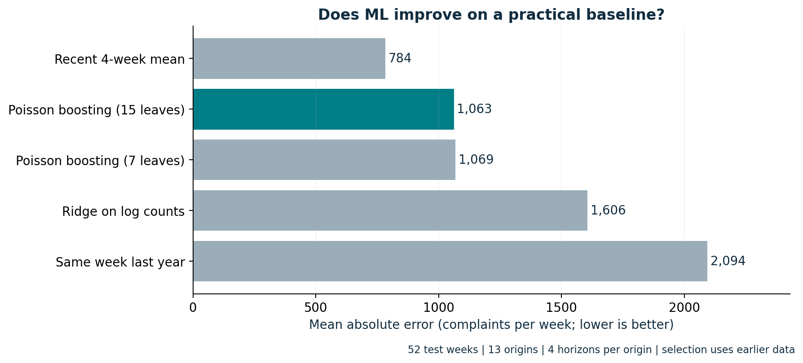

# Forecasting wireless complaint workloads

**Himanshu Jadaun | Project 02 | Built and evaluated November 2, 2026**

Can a nonlinear count model beat a useful operational baseline when complaint volumes change? This study compares direct one-to-four-week forecasts on **1,259,229 observed FCC wireless phone complaints**, aggregated into **460 weeks** from January 1, 2018 through October 25, 2026.

**New technique:** direct multi-horizon count forecasting with rolling-origin residual distributions. Scientific practices include timestamp auditing, sequential temporal evaluation, development-only model choice, empirical interval scoring, paired block-bootstrap uncertainty, horizon/error analysis and target-definition sensitivity.

## Measured result

The recent four-week average was selected on the earlier 104 development weeks and had the smallest final evaluation error. The strongest development-selected ML challenger was Poisson gradient boosting with 15 leaves.

| Model | MAE (complaints/week) | WAPE | Nominal 80% interval coverage |
|---|---:|---:|---:|
| Recent four-week mean | **783.6** | **16.6%** | 69.2% |
| Poisson boosting, 15 leaves | 1,062.5 | 22.5% | 55.8% |
| Poisson boosting, 7 leaves | 1,068.6 | 22.7% | 55.8% |
| Ridge on log counts | 1,605.7 | 34.1% | 38.5% |
| Same week 52 weeks earlier | 2,094.3 | 44.4% | 48.1% |

Final evaluation: **52 non-overlapping target weeks, 13 origins, four horizons per origin**, October 27, 2025-October 25, 2026. Boosting's observed MAE was 35.6% larger than the baseline's. The conditional paired block-bootstrap 95% interval for the ML-minus-baseline MAE difference was **[-195.6, 787.0] complaints/week**, so this short evaluation does not establish universal baseline superiority. It provides no evidence that added ML complexity earns deployment here.



The interval undercoverage is a separate failure. Neither candidate's nominal 80% interval should be treated as a reliable workload commitment. Read [the complete findings](RESULTS_REPORT.md), [data card](DATA_CARD.md), [model card](MODEL_CARD.md) and [audit amendment](PROTOCOL_AMENDMENT.md).

## Run on a Mac or Linux

Use Python 3.12. From the repository root:

```bash
cd projects/02_complaint_forecasting
python3.12 -m venv .venv
source .venv/bin/activate
python -m pip install --upgrade pip
python -m pip install -r requirements.txt
OMP_NUM_THREADS=1 OPENBLAS_NUM_THREADS=1 python study.py --snapshot
python build_figures.py
python diagnose_low_reporting.py
python -m unittest discover -s tests -v
python execute_notebook.py
```

The snapshot command reproduces modelling from the committed anonymous aggregate and verifies its hash. The recorded full study ran on Linux/Python 3.12.14 in about 70 seconds, excluding installation and source access. These commands are written for macOS too; local execution here was Linux, not a Mac. Runtime varies by computer.

For a fresh authoritative source download and audit:

```bash
python download_data.py --refresh
OMP_NUM_THREADS=1 OPENBLAS_NUM_THREADS=1 python run_study.py
python build_figures.py
```

The source API is public and requires no key. `run_study.py` uses a complete cached download when present. Source revisions can change a fresh run; preserve this release before refreshing. `study.py --snapshot` is the route for this exact release's input. Do not run integrity checks with `python -O`, which disables scientific boundary assertions.

## Read and understand

Start with [the executed notebook](analysis.ipynb) and [the two-hour builder's walkthrough](BUILDERS_GUIDE.md). The notebook explains and recomputes the saved experiment's results; full model fitting runs in `study.py`.

| File or folder | Responsibility |
|---|---|
| `experiment_plan.json` | Prespecified target, periods, candidates, metrics, calibration and sensitivity |
| `download_data.py` | Authoritative API queries, retry, licence check, hashes and aggregate audits |
| `run_study.py`, `study.py` | Ingestion entry point, audited aggregation, feature boundaries, model fitting, selection, sequential predictions, uncertainty |
| `build_figures.py` | Five scientific charts with exact CSV data and provenance |
| `diagnose_low_reporting.py` | Post-hoc low-reporting target diagnostic; primary scores and model choices stay unchanged |
| `execute_notebook.py`, `analysis.ipynb` | Rebuild and execute the explanatory companion |
| `results/` | Anonymous frozen source aggregate, audit, manifest, training trace, predictions, model selection and measured results |
| `tests/` | Source, temporal, metric, selection, interval and figure integrity checks |

## Product decision

Retain the recent-average baseline as the reference for a prospective shadow evaluation, rather than deploy the tested ML challenger. Reassess interval estimation and monitor coverage by horizon as new data arrives. Staffing would additionally require handling-time and routing data; no staffing savings were measured here.

Source: [FCC CGB Consumer Complaints, 3xyp-aqkj](https://opendata.fcc.gov/Consumer/CGB-Consumer-Complaints-Data/3xyp-aqkj), Public Domain U.S. Government. These self-selected, unverified complaint counts have no subscriber denominator. They are not carrier churn rates, causal measures of service quality, or employer outcomes. Historical source vintages are unavailable, so this is a current-snapshot historical backtest.
