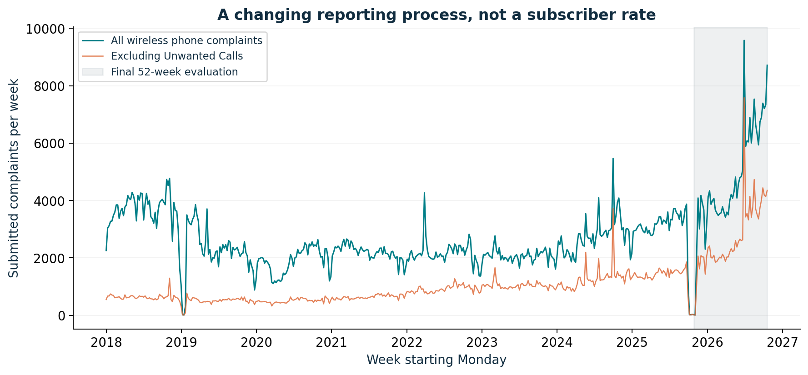
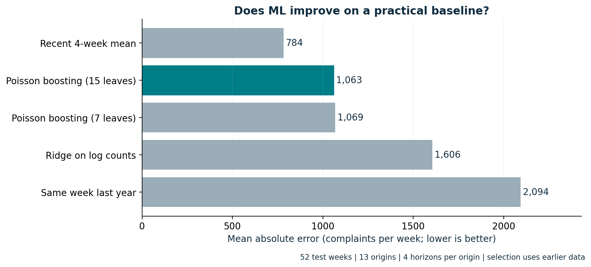
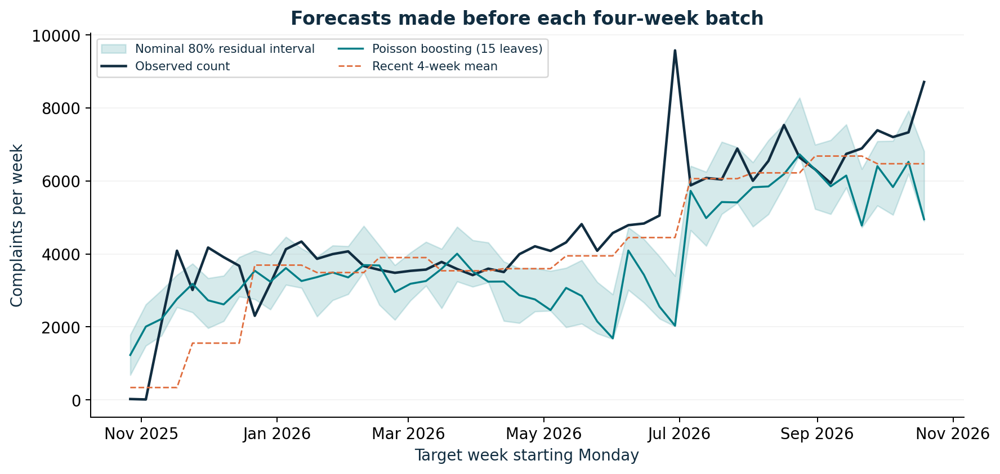
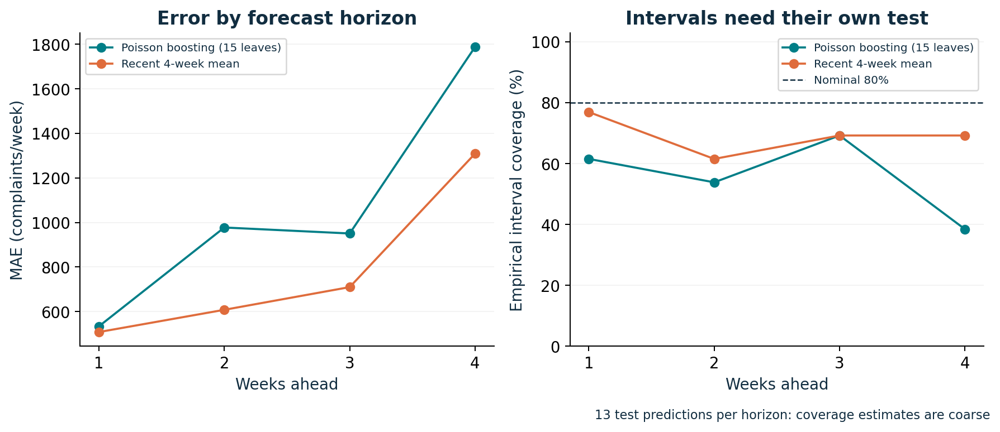
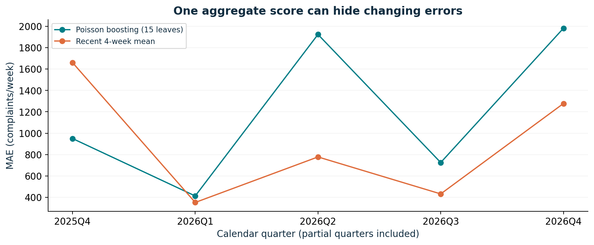

# Findings: complexity did not earn its place

## Question and locked comparison

Would direct multi-horizon count ML improve forecasts of weekly wireless phone complaint totals, and would the forecast intervals support workload planning?

The study uses 1,259,229 observed FCC complaint tickets submitted in the selected scope from January 1, 2018 through October 25, 2026. These form 460 UTC weeks. Models use genuine submission chronology. The source is self-selected and unverified; the target is a report count, with no subscriber denominator.

The prespecified hypothesis allowed ML to win or lose. Development-only MAE selected the recent four-week average overall and 15-leaf Poisson gradient boosting as the strongest ML challenger. The [selection record](results/selection_locked_before_test.json) was saved before final evaluation in the executed sequence.

## 1. Two source issues changed the interpretation

The `date_created` field and the UTC date of documented `ticket_created` disagree for 118,111 records in the final scope. We use `ticket_created` and record the audit-driven amendment. A field-name assumption would have hidden this choice. Timezone differences may explain some or all disagreements; we did not identify their cause.

Unwanted Calls account for 61.64% of complaints in the analysis window. Thus, even a well-performing forecast would not be a clean measure of dissatisfaction with plans, devices or network coverage. We repeat the frozen analysis excluding this issue category.

Eight days have no selected complaints in the source snapshot and are represented as zero. The dataset cannot distinguish true zero arrivals from absent publication. No weekly observations are dropped.

Seven weeks have fewer than 100 selected reports, concentrated in January 2019 and October-November 2025. Two fall in final evaluation. Their cause is unknown. A labelled post-hoc diagnostic scores the remaining 50 test weeks without changing training or model choice: baseline MAE is 802.1 and ML MAE 1,040.9. The observed point-accuracy ranking persists. This is not a complete correction for possible reporting disruption: low weeks still affect lag features and training. See `diagnose_low_reporting.py` and its saved tables.

## 2. The recent-level baseline won the observed comparison

The final evaluation consists of 52 distinct target weeks, October 27, 2025-October 25, 2026, across 13 origins. Four forecasts per origin share a training boundary; they are not 52 independent experiments.

| Model | MAE | WAPE | Bias (prediction minus actual) | RMSE |
|---|---:|---:|---:|---:|
| Recent four-week mean | 783.6 | 16.6% | -563.3 | 1,242.3 |
| Poisson boosting, 15 leaves | 1,062.5 | 22.5% | -849.8 | 1,606.2 |
| Poisson boosting, 7 leaves | 1,068.6 | 22.7% | -848.8 | 1,615.0 |
| Ridge on log counts | 1,605.7 | 34.1% | -1,478.2 | 2,009.0 |
| Seasonal naive, 52 weeks | 2,094.3 | 44.4% | -1,768.0 | 2,868.7 |

All absolute-error units are complaints/week. WAPE divides total absolute error by total observed complaints; it is not a subscriber percentage. The selected ML challenger's MAE was 278.9 complaints/week, or 35.6%, above the baseline. These are realized errors in this evaluation period.

A conditional paired circular block bootstrap gives a 95% interval of **[-195.6, 787.0]** for ML-minus-baseline MAE. It resamples 12-week origin blocks, keeping all four horizons together. With 13 origins and a changing series this interval is approximate. It crosses zero: the study does not establish universal baseline superiority, but it supplies no evidence of an ML gain worth deployment.

## 3. Nominal interval labels overstated empirical reliability

| Model | Nominal coverage | Observed coverage | Mean width | 80% interval score, lower better |
|---|---:|---:|---:|---:|
| Recent four-week mean | 80% | 69.2% (36/52) | 1,309.6 | 4,883.1 |
| Poisson boosting, 15 leaves | 80% | 55.8% (29/52) | 1,505.9 | 5,600.3 |

Intervals use only preceding out-of-sample residuals at each origin/horizon. Despite wider average intervals, boosting had lower coverage and a worse interval score on the primary target. The score penalizes both excessive width and misses. Reporting only an 80% label would have concealed this failure.

These residual intervals have no guaranteed coverage under serial dependence or distribution change. The undercoverage is an empirical finding, not a proof of one causal failure mechanism. Unknown source revisions add another unmeasured uncertainty.

## 4. Error depends on horizon and period

| Horizon | Baseline MAE | ML MAE | Baseline interval coverage | ML interval coverage |
|---|---:|---:|---:|---:|
| 1 week | 507.8 | 533.7 | 76.9% | 61.5% |
| 2 weeks | 607.7 | 977.4 | 61.5% | 53.8% |
| 3 weeks | 709.7 | 950.5 | 69.2% | 69.2% |
| 4 weeks | 1,309.3 | 1,788.4 | 69.2% | 38.5% |

There are only 13 observations per horizon; each outcome moves coverage by 7.7 percentage points. Do not overinterpret small coverage differences. The four-week horizon has the largest realized error for both compared candidates, consistent with the difficulty of planning far ahead in a changing series.

Forty-one of the 52 test weeks exceed the development-period 90th percentile of 3,566.3 complaints/week. This is descriptive evidence of a higher-count evaluation regime, not proof of why reports changed. In those 41 weeks, baseline MAE was 821.0 and ML MAE 1,197.8. In the remaining 11 weeks, ML had smaller MAE (558.3 versus 644.3), but that small diagnostic slice does not override the locked overall decision. Quarter metrics include partial quarters and are descriptive, not independent significance tests.

## 5. Excluding Unwanted Calls did not reverse the point-accuracy result

The frozen sensitivity retained the same model design and primary selection. On the 52 test weeks, the recent average had MAE **469.7**, while the selected ML challenger had MAE **614.2** complaints/week. Coverage was 65.4% and 44.2%. Thus the primary result is not solely an artifact of the Unwanted Calls category.

There is a useful qualification: the ML challenger's interval score was **3,093.8**, better than the baseline's **3,383.0**, despite worse coverage. Width and the magnitude of misses both affect that score. This prevents a simplistic claim that the baseline wins every probabilistic measure on every target. The sensitivity is exploratory and does not provide a new selection opportunity.

## Decision and measurable follow-up

Keep the recent-average baseline as the reference in a prospective shadow study. The tested ML configurations add complexity without an observed point-accuracy gain. Neither nominal interval supports an unqualified 80% workload commitment.

Collect weekly source snapshots and observe publication/revision lag before claiming prospective performance. Evaluate fresh, later weeks against the frozen baseline; monitor MAE, systematic underforecasting, interval coverage, width and interval score by horizon. A future training-window or interval change must be chosen on development evidence and evaluated on a later period. Staffing decisions require handling-time, routing and service-level data that this public source does not contain.

No experiment here measures cost savings, staffing improvement, retention uplift, network effects or an employer outcome. It is an independent public-data forecasting study with a negative ML result and a clear next experiment.
