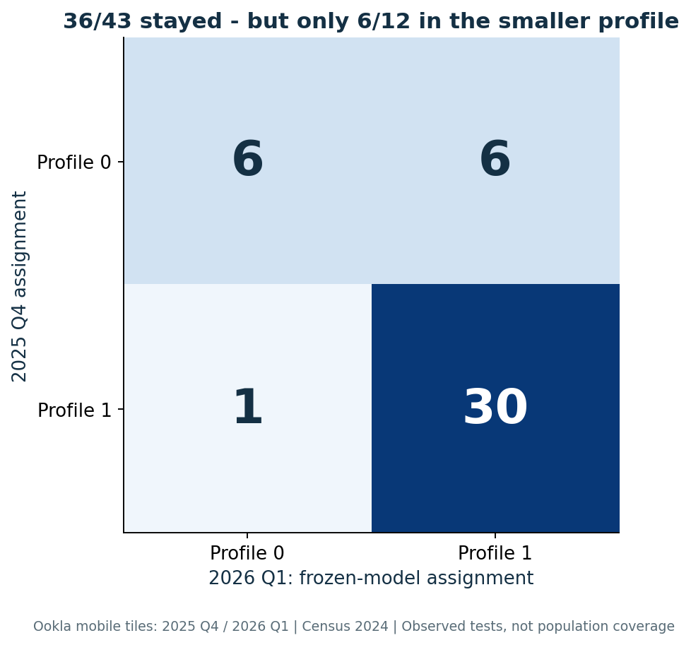

# Stable network-experience profiles?

**Himanshu Jadaun | Project 03 | Built and evaluated November 9, 2026**

This is **unsupervised machine learning**: segmenting Colorado counties by observed mobile-test download, upload and latency, then testing how much the resulting labels depend on the sample, aggregation rule and quarter.

**New technique:** bootstrap-stable segmentation with frozen temporal transfer. The study combines observed Ookla mobile tiles for **2025 Q4 and 2026 Q1** with **2024 Census county boundaries and population context**. It includes audited spatial joins, development-only preprocessing and model selection, a one-profile reference, Ward algorithm sensitivity, 200 tile-bootstrap refits, aggregation sensitivity and later-quarter replication.

## What the experiment found

- Development data: **7,937 assigned tiles, 33,640 observed tests**; 51 of 64 counties meet the five-tile/25-test support rule.
- Selected segmentation: **two profiles**, 14 and 37 counties, development silhouette **0.420**. Larger K candidates fail the minimum-five-counties-per-cluster gate.
- Conditional bootstrap stability: median ARI **0.631**, 2.5th-97.5th percentile range **[0.357, 0.918]**. **12/51 counties** have aligned membership frequency below 80%.
- Equal-tile weighting changes **7/51** assignments under the frozen model.
- Next quarter: **36/43** comparable counties retain their profile (**83.7%**), but only **6/12** counties in the smaller profile do. Temporal ARI is **0.395**.

The profiles are useful descriptive hypotheses. These results do not justify hard market labels or coverage promises. Bootstrap ranges are conditional on observed tiles, not population confidence intervals. Counts and performance refer to self-selected tests, not all subscribers.



[Findings report](RESULTS_REPORT.md) · [Executed notebook](analysis.ipynb) · [Builder's guide](BUILDERS_GUIDE.md) · [Data card](DATA_CARD.md) · [Model card](MODEL_CARD.md)

## Run on a Mac or Linux

Use Python 3.12. From the repository root:

```bash
cd projects/03_network_profiles
python3.12 -m venv .venv
source .venv/bin/activate
python -m pip install --upgrade pip
python -m pip install -r requirements.txt
OMP_NUM_THREADS=1 OPENBLAS_NUM_THREADS=1 python run_study.py
python build_figures.py
python -m unittest discover -s tests -v
python execute_notebook.py
```

The default verifies the committed source-subset hashes and reruns the complete study. The full study ran on Linux/Python 3.12.14 in about 15 seconds, excluding installation and downloads. Mac commands are provided; full macOS model execution is not claimed. The explanatory notebook executes result inspection and independent recomputation, while model fitting runs in `study.py`.

For authoritative source ingestion, spatial assignment and fitting:

```bash
OMP_NUM_THREADS=1 OPENBLAS_NUM_THREADS=1 python run_study.py --download
```

This downloads roughly 371 MB of source files in total, cached under ignored `data/raw/`. It requires no account or API key. Census's API required a key during feasibility checks, so official public bulk population estimates supply context. Live source files can be reaggregated; preserve this release before refreshing. Do not run with `python -O`, which disables integrity assertions.

## Files and decision

| Component | Responsibility |
|---|---|
| `experiment_plan.json` | Question, support gates, K candidates, metrics and frozen replication protocol |
| `download_data.py` | Public downloads, complete file hashes, source licence check, metric validation, centroid spatial join and Census GEOID join |
| `study.py`, `run_study.py` | County summaries, development-only selection, 200 bootstrap refits, sensitivity and frozen-quarter assignments |
| `results/` | Hashed tile subsets, Census context and boundaries, assignments, selection, metrics and execution record |
| `build_figures.py`, `figures/` | Six scientific plots, exact CSV source tables and provenance |
| `execute_notebook.py`, `analysis.ipynb` | Executed explanatory companion |
| `tests/` | Eight checks for identity, aggregation, training boundaries, alignment, support, metrics and figure provenance |

Product decision: use stable profiles to guide a **proposal for additional measurement**, while flagging uncertain or unsupported counties. Validate a later quarter and spatial-block uncertainty before using firm market segments. No carrier ranking, churn prediction, service-coverage percentage or employer outcome is measured.

Based on Himanshu Jadaun's analysis of **Speedtest by Ookla Global Fixed and Mobile Network Performance Maps**, accessed November 9, 2026, for 2025 Q4 and 2026 Q1. Ookla-derived data and figures: **CC BY-NC-SA 4.0**; Census data: U.S. government public domain. See [licence and attribution](DATA_LICENSE.md).
