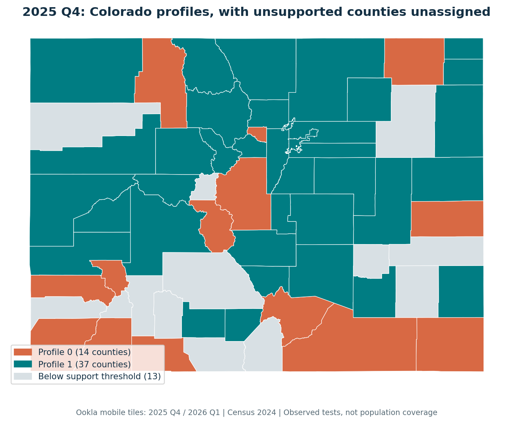
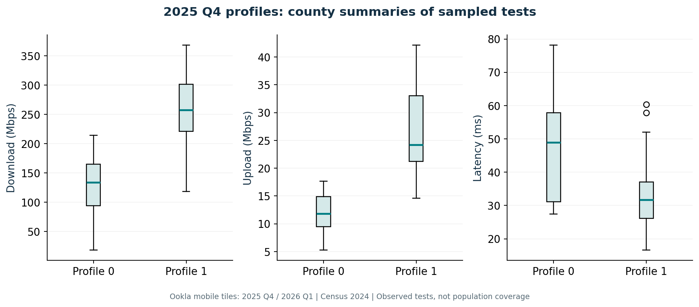
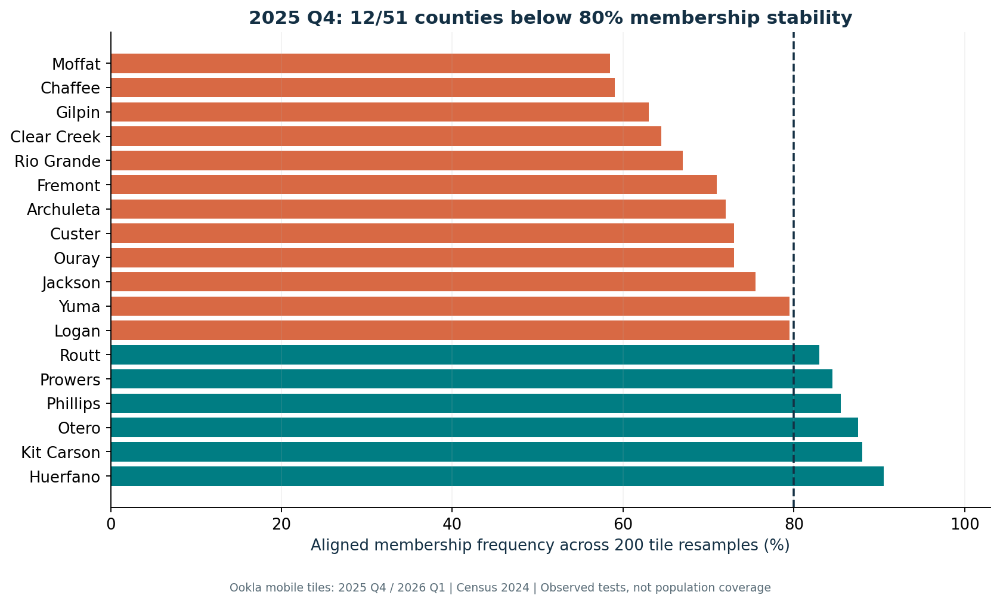
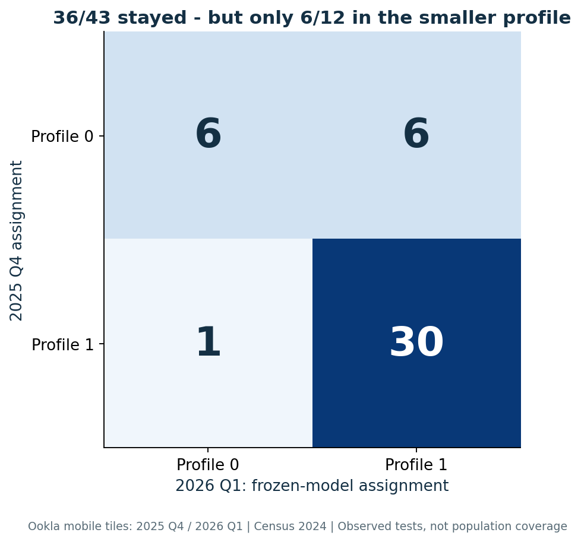
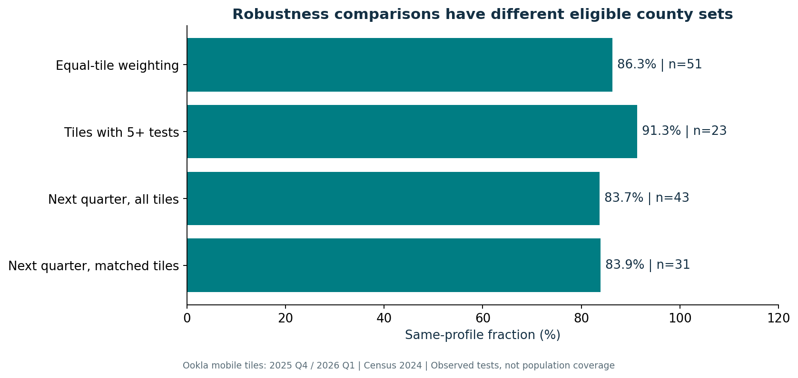
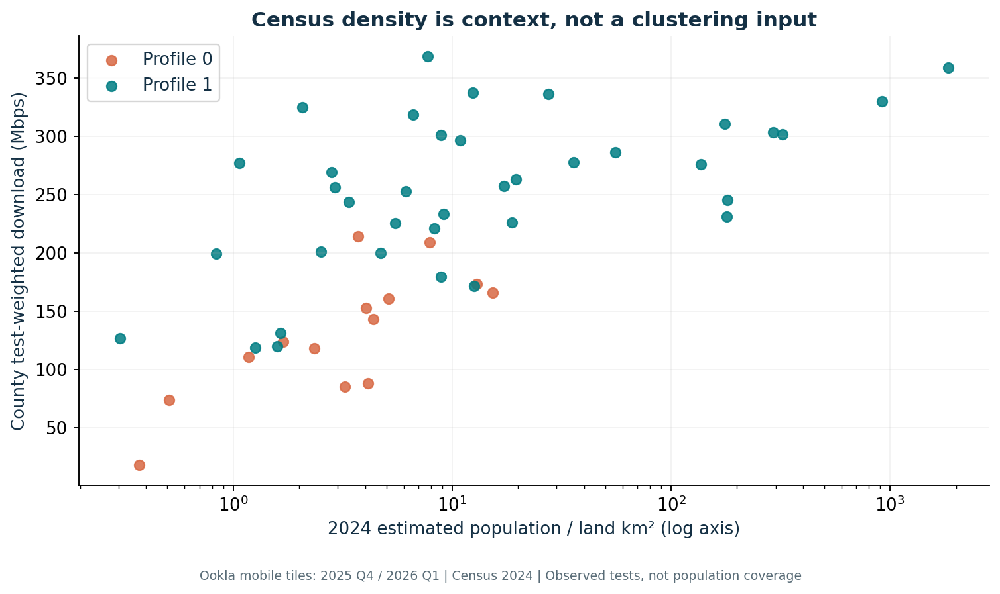

# Findings: stable-looking maps can hide unstable assignments

## Question and design

Do Colorado counties show distinct mobile-test network-experience profiles that persist under resampling, alternative weighting and a later quarter?

The observed foundation is 7,937 assigned Ookla mobile tiles containing 33,640 tests in 2025 Q4. Thirteen of 64 Colorado counties fail the prespecified minimum-five-tiles/25-tests gate, leaving 51 counties for development. The 2026 Q1 source contains 7,312 assigned tiles and 32,102 tests; 45 counties meet support, and 43 overlap development. Exact source and subset identities are saved.

County features are test-weighted published tile means for download, upload and latency, transformed with log1p and development-only standardization. Census 2024 geometry and official population estimates supply compatible county context; density is not a clustering feature or performance-weighting denominator. The API required a key, so public Census bulk files were used.

## 1. Two profiles meet the development criteria

The one-profile reference has standardized squared dispersion 153.0. K=2 reduces within-cluster inertia to 90.1, but such in-sample reduction is expected as K increases; it is not a validated predictive gain. K=1 has no silhouette score.

| Candidate K | Development silhouette | Smallest cluster | Support gate |
|---|---:|---:|---|
| 2 | 0.420 | 14 | Pass |
| 3 | 0.413 | 4 | Fail |
| 4 | 0.305 | 4 | Fail |
| 5 | 0.300 | 1 | Fail |

The prespecified minimum-five-counties-per-cluster gate excludes larger K. Selection and the scaler/centroids are locked before examining replication assignments.

| Selected profile | Counties | Observed tests in eligible counties | Median county download | Median county upload | Median county latency |
|---|---:|---:|---:|---:|---:|
| 0 | 14 | 1,302 | 133.7 Mbps | 11.8 Mbps | 48.9 ms |
| 1 | 37 | 32,176 | 257.5 Mbps | 24.2 Mbps | 31.8 ms |

These are medians across county test-weighted means, not individual-user medians. Profiles have substantial within-group variation. The different test support underscores why an equally colored county map does not imply equally strong evidence everywhere.

## 2. Resampling reveals uncertain boundaries

Across 200 independent within-county tile-bootstrap replicates, with scaler and K-means refit at selected K, median ARI versus the reference partition is **0.631**. The central conditional replicate range is **[0.357,0.918]**. This is a distribution of conditional stability, not a population confidence interval.

**39 of 51 counties** retain their reference membership in at least 80% of aligned replicates. The remaining **12 counties** should carry an uncertainty flag. Moffat and Chaffee have membership frequencies of 58.5% and 59.0%, illustrating that an apparently crisp map can encode fragile assignments. The 80% flag is an operational diagnostic threshold, not calibrated probability of a true group.

Tile resampling ignores neighboring-tile dependence and does not recover raw test variability. Spatial-block resampling and a better observation design may reveal additional uncertainty. Holding the original eligibility set fixed prevents support fluctuations from silently changing which counties are compared within a bootstrap replicate.

## 3. Raw quarter agreement conceals an imbalanced transition

The frozen development model assigns eligible 2026 Q1 counties without retuning K or scaling. **36 of 43 counties (83.7%)** retain their profile. ARI is **0.395**, much weaker than a raw agreement headline might suggest.

| 2025 Q4 profile | 2026 Q1 profile 0 | 2026 Q1 profile 1 | Retained |
|---|---:|---:|---:|
| 0 | 6 | 6 | 6/12 (50.0%) |
| 1 | 1 | 30 | 30/31 (96.8%) |

The smaller profile loses half its comparable members. A single overall percentage is therefore insufficient. These are county-level summary transitions, with changing observed test participation; they do not prove changes for the same customers or identify a cause.

Intersecting tile identities first gives 3,294 matched tiles and 31 eligible counties. Frozen assignments retain **26/31 (83.9%)**, but ARI is only **0.164**. Matching locations partially addresses spatial sample turnover; devices, tests and their weights can still differ. The eligible county set also differs from the 43-county full-quarter comparison, so these percentages are not paired estimates on identical support.

## 4. Aggregation assumptions matter

| Frozen-model check | Comparable counties | Same profile | ARI |
|---|---:|---:|---:|
| Equal-tile vs test-weighted development summaries | 51 | 44/51 (86.3%) | 0.508 |
| Only tiles with five or more tests | 23 | 21/23 (91.3%) | 0.547 |

Equal-tile weighting changes **7 of 51** labels. It asks a different descriptive question: average sampled location rather than average observed test activity. Neither is automatically representative of residents. Restricting tile support removes many counties, so its higher agreement cannot be interpreted as a better result for all 51.

Ward hierarchical clustering on the same standardized development observations yields ARI **0.843** versus K-means. This supports some same-sample algorithm consistency, but is not independent validation.

## 5. Census context stays descriptive

Median estimated population density is 3.9 versus 8.9 people per land km² in profiles 0 and 1. This uses Vintage 2024 official estimates and 2024 county land area. It is contextual, from an earlier reference year, and not an individual feature or identified cause of performance.

No population weighting or subscriber denominator is used. No coverage percentage or demographic causal conclusion is estimated.

## Decision and next evidence

Use the profiles as descriptive hypotheses for a follow-up measurement plan. Flag the 12 counties with low conditional membership stability and leave unsupported counties unlabelled. The smaller profile's temporal instability and aggregation sensitivity argue against assigning firm market tags or using the map for carrier ranking, coverage commitments or customer targeting.

Next steps: collect later quarterly snapshots, test spatial-block resampling, quantify sensitivity to centroid assignment near generalized county boundaries, and design measurements that include unobserved locations. Evaluate whether a proposed action improves a separately measured outcome before claiming business value.

The study uses observed public tests and official Census context. It does not use employer information or establish subscriber experience, churn impact, carrier effects or causal network quality.
