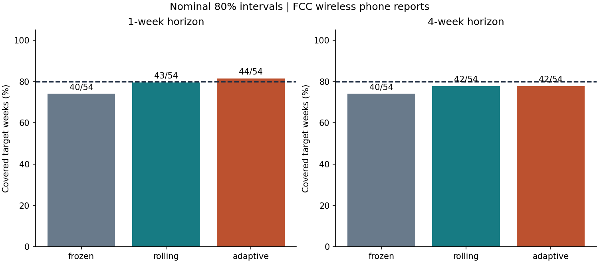

# Forecast interval reliability under temporal shift

Project 04 · November 16, 2026 · Himanshu Jadaun's Retail Wireless Data Science Lab

Can **adaptive conformal-style calibration** improve nominal 80% intervals for weekly FCC wireless phone reports without paying too much in width? This extension of Project 2 freezes the point-forecast rule across interval methods and changes how uncertainty is calibrated.

At four weeks, both adaptive and rolling methods covered **42/54** weeks. The adaptive mean width was **4,371** reports versus **3,769**, and its mean interval score was **8,666** versus **7,975**. The frozen reference covered **40/54**, with mean width **2,326** and score **6,736**. The replay supports monitoring coverage and upper misses by horizon before using the intervals for workload planning.

- [Findings](RESULTS_REPORT.md) · [Builder's guide](BUILDERS_GUIDE.md) · [Dataset](DATA_CARD.md) · [Model](MODEL_CARD.md) · [Experiment record](EXPERIMENT_RECORD.md)
- [Executed notebook](analysis.ipynb) · [Protocol](protocol.json) · [Saved predictions](results/predictions.csv)



## Reproduce on macOS or Linux

Use Python 3.12. From the repository root:

```bash
cd projects/04_interval_reliability
python3.12 -m venv .venv
source .venv/bin/activate
python -m pip install -r requirements.txt
python run.py
python -m unittest -v
python notebook.py
```

This uses the hashed daily aggregate. Run `python source.py` in a separate checkout to retrieve the same date range from the FCC API. A later snapshot can differ and will require rechecking snapshot-specific regression tests. Full execution was on Linux. The data are reports submitted to the FCC, and the historical evaluation uses one later extract rather than archived publication vintages.
