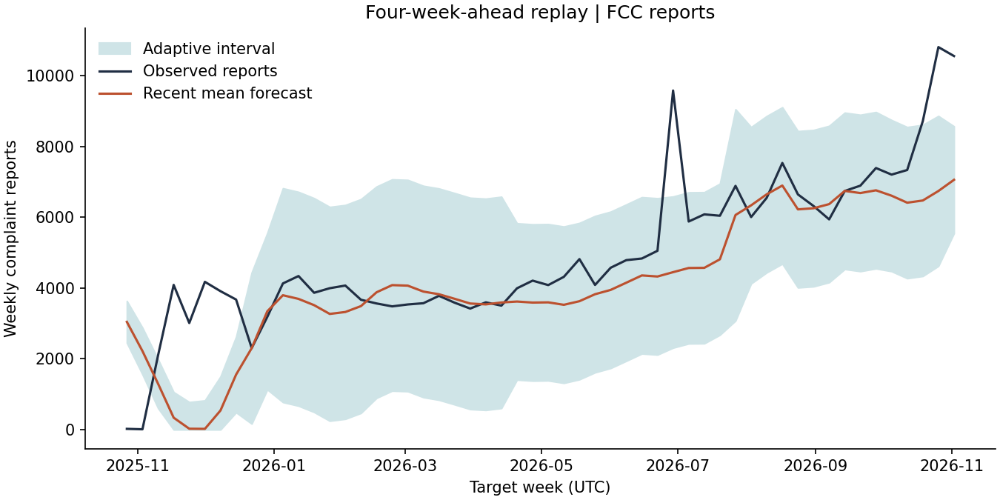

# Coverage and width under temporal shift

The hypothesis was that bounded adaptive calibration would improve observed coverage versus frozen residual intervals, with an uncertain cost in width and interval score. We compared identical target weeks and recent-mean point forecasts, using only outcomes resolved by each Monday issue. Development scoring selected gain 0.01 from three candidates. The last development target was September 29, 2025 and resolved by October 6, the earliest issue date for the 54 evaluation target weeks. Evaluation runs from October 27, 2025 to the week beginning November 2, 2026.

| Horizon | Method | Covered weeks | Mean width (reports) | Mean interval score | Above upper bound |
|---|---|---:|---:|---:|---:|
| 1 week | Frozen | 40/54 | 1,552 | 4,408 | 12 |
| 1 week | Rolling | 43/54 | 1,923 | 4,863 | 10 |
| 1 week | Adaptive | 44/54 | 1,845 | 4,799 | 9 |
| 4 weeks | Frozen | 40/54 | 2,326 | 6,736 | 12 |
| 4 weeks | Rolling | 42/54 | 3,769 | 7,975 | 10 |
| 4 weeks | Adaptive | 42/54 | 4,371 | 8,666 | 10 |

The interval score adds width plus ten times the distance missed outside the band. Lower is better at the nominal 80% level. The frozen reference scores best and undercovers at both horizons. At one week, adaptive is slightly sharper and covers one more week than rolling. Mean adaptive-minus-rolling score is **−64** with a conditional four-week-block central range of **[−252, +106]**. At four weeks the same difference is **+690**, range **[+281, +1,119]**. Eight-week blocks preserve the qualitative result, with ranges [−206, +67] and [+231, +1,194]. These are paired resampling summaries conditional on the realized predictions and target weeks, with 2,000 circular moving-block draws. They omit refit uncertainty and cannot fully account for nonstationarity. No IID fold tests were used.

The four-week adaptive method covered **18/26** early target weeks and **24/28** later weeks. The rolling method yielded the same counts within both periods. Overall coverage obscures this change, and 10 of 12 adaptive misses were above the upper bound. The periods are fixed chronological slices, with no causal label assigned to the change.

Recent-mean point MAE was **696/1,076** reports at horizons one/four. The seasonal naive point MAE was **2,412** at both horizons. Interval comparisons hold the recent-mean point forecast fixed, so a method cannot improve its score by changing the center.

With a hypothetical two-week availability lag applied to both feature and feedback clocks, four-week adaptive covered 42/54 versus 39/54 for rolling, with widths 5,908 versus 3,477. Excluding Unwanted Calls reduced the frozen four-week coverage to 12/54, while rolling and adaptive each covered 44/54. Rolling used a smaller mean width (1,897 versus 2,667). The issue filter changes the target stream. The fixed lag is a sensitivity assumption and does not estimate actual publication delay.

**Decision.** Retain rolling as a diagnostic reference, with frozen intervals as a sharpness benchmark. Evaluate candidate policies on prospective arrival-vintage snapshots before staffing use. Track upper misses per horizon, 13-week coverage, average width and interval score together. This replay did not measure operating cost or carrier outcomes. Some evaluation weeks had been discussed in Project 2, and the later FCC extract cannot reproduce real-time vintage availability.
