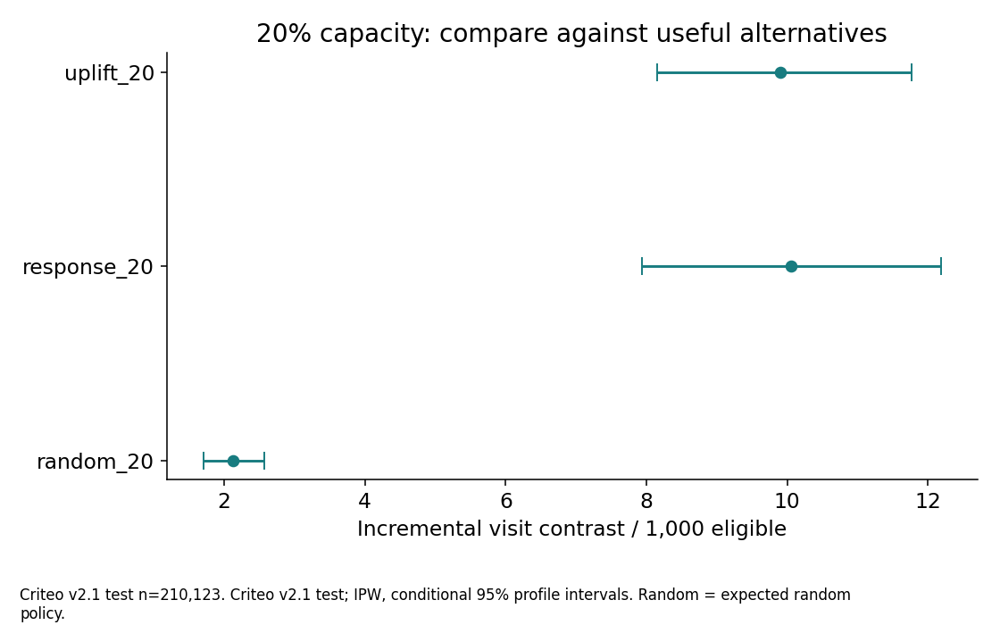

# Project 05: Response is not uplift

**Question:** At a hypothetical 20% advertising assignment capacity, does uplift ranking improve held-out visit contrast over random targeting and response ranking?

This is an executed noncommercial Data Science study using observed **Criteo CRITEO-UPLIFT v2.1** randomized-source advertising data. It is an explicit method-transfer study for retail wireless product science, not a telecom dataset or carrier-retention result. New technique: **T-learner uplift ranking with held-out inverse-propensity policy evaluation**.

## Measured finding

On **210,123 held-out rows**, the validation-selected 7-leaf boosted T-learner at 20% capacity produced **9.90 incremental visit contrast per 1,000 eligible users** (conditional 95% profile multiplier interval **8.15–11.76**). Expected random allocation produced **2.13** (1.71–2.57). The paired advantage over random was **7.77** (6.33–9.30), but versus logistic response ranking it was **−0.16** (−1.36–1.37). This study does **not** establish superiority to response ranking.

These are IPW contrasts in the publisher's privacy-altered released benchmark under a working assignment model. Nonuniform privacy selection prevents recovering original campaign incrementality. There are no measured retention, revenue, employer or current carrier outcomes.



## Run on a Mac or Linux

Install Python **3.12** (for example `brew install python@3.12` on a Mac), then:

```bash
git clone https://github.com/Himalytics/wireless-data-science.git
cd wireless-data-science/projects/05_uplift_policy
python3.12 -m venv .venv
source .venv/bin/activate
python -m pip install --upgrade pip
python -m pip install -r requirements-lock.txt
python run.py
python verify_refit.py
python -m unittest -v test_integrity
python -m ipykernel install --user --name python3 --display-name 'Python 3'
python notebook.py
```

The first run downloads 311 MB compressed, checks the publisher SHA256, scans all 13,979,592 rows and keeps a deterministic approximately 5% sample. Allow several minutes for modelling and profile uncertainty; network and hardware vary. Use at least about 2 GB free disk and 4 GB memory. No keys, paid accounts or raw-data manual edits. Cached local inputs remain ignored. To force a source re-audit, remove only `data/sample.pkl`, then rerun. Do not unpickle untrusted caches. Full reruns overwrite generated study outputs: preserve a separate experiment before exploring scientific changes.

Recorded execution is Linux; full model training on macOS has not been observed. The GitHub workflow runs frozen-output integrity tests on Linux and macOS, which is different from full model training. The test command alone needs committed evaluation outputs, not the source download. `notebook.py` executes explanation and metric recomputation against saved outputs; it does not silently retrain models.

On the recorded host Jupyter kernel sockets were unavailable; `python notebook.py --in-process` executed all seven real cells with IPython and captured rich outputs. Normal Mac users can use the kernel command above. The in-process mode is also available without socket access; the notebook records which method actually executed it.

## Read and reproduce

| File | Role |
|---|---|
| [protocol.json](protocol.json) | Question, primary comparison, candidate budget, exclusions, capacities and uncertainty locked before test |
| [source.py](source.py) | Pinned download, hash/schema checks, bounded-memory sample and profile split |
| [run.py](run.py) | Training, validation selection, held-out predictions, evaluation, uncertainty and figures |
| [analysis.ipynb](analysis.ipynb) / [notebook.py](notebook.py) | Executed scientific explanation and regeneration |
| [test_integrity.py](test_integrity.py) | Boundary, provenance, metric, allocation and support checks |
| [results/](results/) | Source identity, experiment, split IDs, predictions and exact figure data |
| [RESULTS_REPORT.md](RESULTS_REPORT.md) | Hypotheses, results, negative finding and product decision |
| [DATA_CARD.md](DATA_CARD.md) / [MODEL_CARD.md](MODEL_CARD.md) | Data rights, identification limits, model and inference assumptions |
| [BUILDERS_GUIDE.md](BUILDERS_GUIDE.md) | Two-hour entry, file-level design, alternatives and daily ownership exercises |
| [EXPERIMENT_RECORD.md](EXPERIMENT_RECORD.md) | Actual execution and verification evidence |

Scientific practices include grouped independent evaluation, assignment/overlap audit, conditional paired cluster uncertainty, simple business/statistical baselines, capacity and estimator sensitivity. No fabricated calendar, treatment or subscriber linkage is introduced. Data-derived outputs are attributed to Criteo/Diemert et al. (2018) and licensed CC BY-NC-SA 4.0; see the dataset card before reuse.
